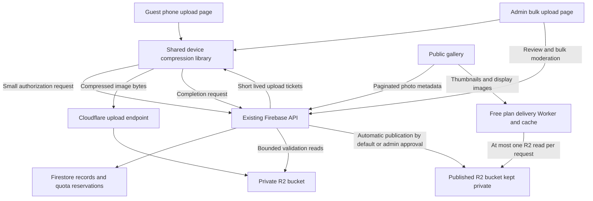

# Gallery architecture draft

Date: November 4, 2026. Status: proposal for review before implementation. Cost review requires controlled image delivery in place of direct public bucket access.

Guests upload photos during the gala, and management can upload a large batch after the event. Guest photos become publicly visible automatically after technical validation by default. Management can hide or show them afterward, individually or in bulk, and can switch on approval before publication if needed. Both upload experiences compress photos on the uploading device. Firebase manages permissions, records and moderation; Cloudflare R2 stores the compressed files. A Worker on the Free plan gates uploads and image delivery, with caching and no image encoding. The required Cloudflare charge is $0: pause work at limits rather than enable paid capacity.

This proposal extends [the gallery handover](CLOUDFLARE_GALLERY_HANDOVER.md). The device compression decision supersedes its server encoding proposal. Endpoint names and limits below are drafts, not implemented API contracts. Existing invitations, RSVP, food reservations and admin authentication retain their current behaviour.

## Decisions and assumptions

| Item | Position |
| --- | --- |
| Compression | Confirmed: on the guest or admin device, including large admin batches |
| Publication | Confirmed: automatic guest publication after validation is the default; approval before publication remains an admin option |
| Management | Confirmed: hide/show individually or in bulk, using the same underlying approve/unapprove actions; hidden photos remain available to admins |
| Guest experience | Confirmed: seamless flow with automatic compression, authorization, completion and publication behind one share action |
| Cloudflare cost | Required: $0; stop uploads or delivery at the relevant limit rather than buy additional capacity |
| Storage | Cost-review revision: submissions and published-copy buckets both remain private; publicly viewable images are delivered through a Free-plan Worker |
| Guest access | Working assumption: one shared event QR and no guest login; personal invitation links remain an alternative |
| Gallery audience | Confirmed: approved photos are publicly readable |
| Originals | Confirmed: never upload or retain camera originals; keep them on the source device |
| Admin batch size | Confirmed planning range: 500–2,000 photos; budget example uses 2,000 admin photos plus an assumed 2,000 guest photos |
| Implementation | Begins after architecture review; this draft creates no cloud resources |

## System and responsibilities

| Component | Responsibility |
| --- | --- |
| Shared browser library | Orientation, resizing, compression, metadata removal, checksums and output verification; used by both upload interfaces |
| Public frontend | QR landing page, camera and file picker, preview, progress and retries; gallery layout remains the frontend developer's responsibility |
| React admin app | Device compression queue, bulk upload, review, filters, gallery settings and bulk moderation |
| Firebase API | Reuse Node/Joi, existing admin session, Firestore and error envelope; authorize uploads, reserve capacity, verify completion and manage publication |
| Upload endpoint | Small Cloudflare Worker: verify tickets, claim a reserved write attempt through Firebase, enforce actual byte length and write only the permitted staging object |
| Private R2 | Staging uploads and retained compressed copies; no public domain or r2.dev access |
| Published R2 | Automatically published or admin-approved compressed copies only; bucket access remains private and readers use the delivery Worker |
| Image delivery | Worker on the Free plan: verify short-lived view capabilities, check its cache and make at most one R2 read on a miss; no resizing, image decoding or Firestore query for each view |
| Cleanup and repair | Small scheduled, bounded maintenance task for expired uploads and interrupted copy/delete operations; no image encoding |

The Worker has no admin login, direct Firestore connection, image decoder or image transformation service. Compared with the earlier proposal, gallery images now also pass through the Free-plan request limit. This trades unlimited availability for a stronger spending boundary. Both buckets must have r2.dev and direct public custom-domain access disabled. Two buckets remain useful for access separation, but a single private bucket with separate prefixes could also work behind this controlled delivery path.

## Device compression contract

Both interfaces use the same versioned compression library and server-provided policy. Start with the following test targets:

| Output | Maximum long edge | Target bytes | Hard byte limit |
| --- | --- | --- | --- |
| Thumbnail | 400 px | 20–50 KB | 50,000 bytes |
| Display | 1,600 px | 150–300 KB | 500,000 bytes |

Sizes are decimal; a photo means a pair of files totalling at most 550,000 bytes. Preserve aspect ratio and avoid upscaling. Quality, minimum usable dimensions and byte limits must be confirmed against actual faces, group photos and dim indoor scenes.

1. Decode one source photo at a time, apply orientation and redraw the pixels without copying source metadata. Normalize colour for ordinary screen display.
2. Generate both variants from the decoded source. Prefer WebP when encoding is supported; use JPEG as the fallback. Inspect actual output MIME type and size because unsupported canvas encoding can fall back to PNG. [Browser encoding behaviour](https://developer.mozilla.org/en-US/docs/Web/API/HTMLCanvasElement/toBlob)
3. Use bounded quality and size adjustments, with a quality floor. Report an individual compression failure rather than uploading an oversized original or silently producing an unusable image.
4. Decode the generated outputs locally to verify the result, then compute SHA-256 digests of their bytes. Send only the compressed outputs.
5. Release the source bitmap, canvases and preview URLs before advancing through a large queue. A browser Web Worker may keep supported operations responsive; processing still runs on the user's device.

Input scope is still photos. JPEG, PNG and WebP are initial candidates. HEIC/HEIF needs an on-device conversion path, potentially loaded only when needed. Camera capture and photo-library selection must both be tested on iPhone Safari. Animated images, videos, SVG and camera RAW files are outside the initial scope. A photographer's RAW collection must first be exported to a supported still-image format.

Source file size and decoded pixel limits are separate from upload limits. Benchmark a provisional 30 MB and 50 megapixel source ceiling on the supported devices before adopting it; process large sources sequentially. Unsupported or unsafe-to-decode sources get a clear per-file error, without a backend conversion fallback.

## Guest upload journey

The normal guest experience is **scan QR → take or choose photos → preview and tap Share photos → photos appear in the gallery**. The guest does not choose compression settings or perform a separate submit-for-approval step.

1. The event QR opens a stable HTTPS upload page with Take a photo and Choose photos as the main actions. Keep the normal file-picker fallback. The page contains no storage credential or temporary upload ticket.
2. The guest previews their choices, can remove any they do not want to share, and taps Share photos once. A short notice beside that action explains that photos will appear publicly and management may hide them. Under the shared-QR assumption, require no sign-in, RSVP, name, email, caption or separate registration form.
3. The page compresses and uploads automatically, showing one understandable progress sequence such as Preparing → Uploading → Adding to gallery. Ticket requests, capacity reservations, variant uploads and completion calls are internal steps. Camera originals never leave the device.
4. In the default automatic mode, each photo appears after technical validation and successful publication, without an admin action or another guest confirmation. Show Your photos are in the gallery only for confirmed published photos, with View photos and Add more photos actions. If management has enabled prior approval, show Uploaded — awaiting approval instead.

Publish completed photos independently; one failed file must not hold back the rest of a selection. Retry transient failures automatically a bounded number of times and offer Retry failed photos afterward. Preserve successful uploads and local progress, display actionable per-file errors, and explain that the page must stay open while work is active. Do not replace a failed compression with an original-file upload.

The API applies the event upload window, guest/session limits and global capacity checks, reserves capacity transactionally, and returns the authoritative completion state. The frontend resumes or polls unfinished completion operations with bounded backoff; it never asks the guest to press a second publish button. Technical validation is not human content approval in automatic mode.

After publication, update the uploader's gallery view using the confirmed public photo records, without a full page reload. Other viewers receive the photo in subsequent feed requests; live updates in an already-open gallery are a separate frontend feature, not a requirement for automatic publication. Never insert an unverified local preview into the shared public feed as if it were published.

A shared QR does not establish a person's identity. A browser session limit is a convenience limit, not a reliable per-person allowance. Apply layered request controls, an event-wide cap and an admin upload switch. Integrate a server-verified bot check without a routine guest task where possible; show an interactive challenge only if verification requires it, and handle a failed check clearly. Avoid a strict IP-only allowance: guests may share the venue's Wi-Fi.

## Post event admin bulk upload

The existing React management application gets an Upload photos panel for the expected 500–2,000-photo batch. Management can select the collection at once; the app works through it incrementally.

| Control | Proposed behaviour |
| --- | --- |
| Publication choice | Follow gallery setting by default; explicit admin choices to publish after validation or hold the batch for review |
| Compression | One source decoded at a time initially; the same outputs and limits as guest uploads |
| Transfer | Start with two concurrent photo transfers and small authorization groups, such as 20 photos |
| Feedback | Total selected, compressed, uploading, completed, awaiting approval, published, skipped and failed; show byte savings |
| Pause | Stop starting new work; allow current requests to finish, or cancel them explicitly |
| Retry | Retry failed items only; retain successful photo IDs and do not restart the batch |
| Resume | Save batch IDs and completed item records locally; reconcile with the server before retrying |
| Session expiry | Pause new authorizations and require admin sign-in before continuing |

Selecting 2,000 files must not decode 2,000 files or retain every compressed file in memory. Keep a bounded local buffer, provisionally 25 MB, with backpressure when uploads are slower than compression. Persist bounded compressed items in IndexedDB where available and handle storage exhaustion.

After a reload, browsers may require the admin to select the source files again. Resume means matching the selection to saved progress and uploading unfinished items; it does not promise unattended work after the tab closes or the device sleeps. File names, sizes and modification times help match selections, while compressed-byte digests confirm exact retries. Exact duplicate detection does not identify visually similar photos or guarantee the same encoding across different devices.

The guest upload window can close after the gala while authenticated admin uploads remain open. Admin uploads bypass guest/session allowances, but share the event storage and photo caps. A large batch does not reserve capacity for every selected source at once.

## Upload authorization and validation

Firebase issues a short-lived, gallery-specific signed ticket for each variant. It identifies the photo, attempt, server-generated staging key, exact compressed byte count, digest, allowed format and expiry. The signing key is separate from the admin session key. Keep tickets out of URLs and logs where practical, and never expose the R2 credentials.

Authorization uses a stable client request ID and batch item ID, so retrying an uncertain request returns the existing reservation and photo IDs. A renewal or replacement attempt is explicit and cannot silently create another photo. Configure the Worker's CORS policy for the exact public/admin origins and required methods and headers; CORS does not replace ticket verification.

The upload Worker verifies the ticket and calls a protected Firebase claim operation once per upload attempt. That operation atomically consumes one reserved R2 write allowance and prevents concurrent/replayed tickets from starting unlimited writes. If Firebase cannot confirm the claim, do not write to R2. A retry reconciles a consumed attempt or requests a separately budgeted replacement; uncertain attempts remain charged against the application allowance.

The Worker permits only the named object, enforces the exact body length with a bounded stream and asks R2 to verify the supplied digest. An atomic create-only conditional write additionally prevents overwrites. Verify replay and concurrent-write behaviour in the initial technical test. R2 exposes conditional writes and checksum checks; Workers exposes a stream that errors on too many or too few bytes. [R2 upload primitives](https://developers.cloudflare.com/r2/api/workers/workers-api-reference/), [bounded streams](https://developers.cloudflare.com/workers/runtime-apis/streams/transformstream/#fixedlengthstream)

Successful retries reconcile an existing object by its expected digest instead of overwriting it. An interrupted transfer can retry the same attempt; a deliberately replaced image gets a new authorized attempt with separately reserved space. Staging objects are not deleted until all corresponding upload tickets have expired, preventing a valid old ticket from recreating an object after its reservation was released.

Completion reads actual object metadata and bounded file contents, checks byte count, digest, file signature, parsed dimensions, allowed format and prohibited metadata blocks, then copies the accepted files to server-controlled retained keys. Metadata from the browser is not authoritative. If full pixel decoding is omitted to keep backend work low, document that these checks are structural rather than a guarantee that every malformed image will render. Local decode checks improve the normal upload path but do not make a modified browser trustworthy.

No server resizing, re-encoding or metadata repair occurs. Reject files that fail the accepted contract. Publication uses only verified retained keys; old upload tickets cannot modify them. Authorization expiry, cleanup and rate controls remain necessary even when upload bytes are bounded.

## Moderation and publication

The event setting is Require approval before display, **off by default**.

| Mode | New valid guest photos | Admin actions afterward |
| --- | --- | --- |
| Automatic publication — default | Publish immediately after validation and successful R2 copies, without human review | Hide or show, individually or in bulk |
| Approval before publication | Remain private and await review | Approve/show or leave hidden, individually or in bulk |

Automatically published photos have an approved review state with approvalSource=automatic. This records permission to publish; it does not claim a person reviewed them. Admin approvals record approvalSource=admin.

Evaluate the current publication setting when a guest photo first passes validation, and store the chosen policy version on that photo. Turning prior approval on therefore holds guest photos that have not yet completed validation, even if their upload tickets were issued earlier. Retries keep an existing photo's moderation decision rather than recalculating it.

Changing the setting leaves already published photos visible and never republishes previously hidden or pending photos. Only an explicit admin show/approve action does that. Admin batch overrides are explicit and stored with the batch; a batch following the event setting uses the same decision point as guest photos. Guests cannot request an override or submit an approval state.

| State field | Values and purpose |
| --- | --- |
| Upload state | authorized, uploaded, validating, ready, failed, expired |
| Review state | pending, approved, unapproved; independent of upload progress |
| Delivery state | private, publishing, published, unpublishing, error |

The public feed requires ready + approved + published. A partially uploaded or partially copied photo cannot appear in it.

Approving copies the retained thumbnail and display image inside R2 to a new public generation. Only after both exist does the API mark the photo published. Unapproving removes it from fresh public API results first, deletes public objects and purges their cached URLs. A later approval gets new public URLs.

Firestore updates, R2 copies and cache purges do not form one transaction. Use an idempotent per-photo operation record, desired state and revision check. Serialize competing actions for a photo and check the revision again before publication; a stale approval must not undo a later unapproval. Interrupted operations remain visible in admin and can be retried by bounded maintenance work.

Bulk actions use explicit selected photo IDs in chunks, provisionally 25 photos, with success/failure results per item. Retry failed items without repeating completed work. Selection across pages must show its scope and count. Admin filters include batch, source, review state and failed delivery operations.

Use Visible and Hidden as the main admin labels in automatic mode, with Hide selected and Show selected actions. Include Awaiting approval when prior approval is enabled, along with uploading and failed states. Hiding retains the private compressed copies; showing still requires a ready, validated photo. Failed validation can never be bypassed by an admin visibility action.

## Storage and image delivery

Proposed keys are scoped to gala-2026 and opaque photo IDs; they never include invitation codes or guest names.

| Location | Contents |
| --- | --- |
| Private staging prefix | One upload attempt's compressed variants; temporary |
| Private retained prefix | Verified compressed variants for pending, approved and unapproved photos |
| Published generation prefix | Publicly viewable copies in a private bucket, replaced with new keys on republication |

Keeping private copies of approved photos supports admin review and later republishing without asking anyone to upload again. These are compressed copies, not originals.

Attach a photos subdomain of an already-owned domain to the delivery Worker, subject to zone ownership and Free-plan support; an appropriate workers.dev endpoint is an alternative. Do not attach a public R2 custom domain or enable r2.dev on either bucket. A public bucket would bypass the delivery limit and leave billable reads uncontrolled. [R2 public access and caching](https://developers.cloudflare.com/r2/buckets/public-buckets/)

The public API returns opaque IDs, thumbnail/display URLs, actual dimensions and publication timestamps, with cursor pagination starting at 20 photos. Public image URLs carry short-lived, scoped viewing capabilities issued only for published generations. These are separate from upload tickets and require no guest login. They bind the allowed generation and variant, so the Worker does not query Firestore for every view. Expired links can be refreshed from the feed while preserving the guest's view.

The API exposes no private keys, uploader identity, upload tickets or admin previews. It retains the current no-store API behaviour initially. Load thumbnails in the grid and display variants on demand. After capability verification, the Worker caches images under a stable generation/variant key rather than creating a cache entry for every expiring signature. Cached images must still pass through the Worker on subsequent requests; do not rely on an origin route that bypasses it.

Admin previews also use short-lived Worker viewing capabilities, issued through the existing authenticated API, with private caching rules. Do not issue browser-facing R2 presigned GET URLs: those could bypass the controlled read path. Viewing capabilities are temporary bearer links, kept out of logs and analytics. Serve image responses from a separate origin with fixed image MIME types and nosniff.

Propose a five-minute browser and edge cache lifetime during active moderation, with explicit purge on unapproval and retries if a purge fails. Fresh feed responses exclude unapproved photos immediately; previously issued responses or cached files can persist during that window. Already downloaded copies and open image elements cannot be recalled. Set the CDN rules consistently with that window rather than giving images an overriding long edge lifetime.

## Metadata and draft API additions

Reuse the existing Firestore access rules: browsers do not access the database directly.

| Record | Main contents |
| --- | --- |
| GallerySettings/gala-2026 | Policy version, approval requirement, guest/admin upload switches, format/size limits and configured capacity |
| Photos | Event and batch IDs, source guest/admin, upload/review/delivery states, approval source, applied policy version, desired revision, private references, public generation, verified sizes/dimensions/digests and timestamps |
| GalleryUploadBatches | Source, explicit admin publication override, compression policy snapshot and creation time; progress derived from photo records initially |
| GalleryCapacity | Retained bytes, reserved temporary/copy bytes, photo reservations and monthly R2 operation allowances, updated transactionally |
| GalleryOperations | Per-photo publication/unpublication progress, attempts and repair status |

Store references rather than expiring URLs. Record admin username and timestamps using the current login model; a shared admin account cannot identify individual operators. Add only indexes required by the accepted filters and ordering.

| Method and draft route | Purpose |
| --- | --- |
| GET /v1/gallery/policy | Compression rules, supported formats and public upload availability |
| POST /v1/gallery/uploads | Authorize a bounded guest upload group and reserve capacity |
| POST /v1/gallery/uploads/{photoId}/complete | Idempotently validate the stored pair and advance its state |
| POST /v1/gallery/uploads/{photoId}/status | Retrieve an individual submission's status with its private completion capability in the request body |
| GET /v1/gallery/photos | Paginated published feed |
| GET and PATCH /v1/admin/gallery/settings | Read or change event settings |
| POST /v1/admin/gallery/batches | Create a post-event upload batch and record its publication choice |
| POST /v1/admin/gallery/uploads | Authorize admin uploads using the existing session |
| POST /v1/admin/gallery/uploads/{photoId}/complete | Complete admin uploads under the existing session |
| GET /v1/admin/gallery/photos | Paginated review and batch progress, with authorized previews |
| POST /v1/admin/gallery/actions | Bounded approve/unapprove actions with per-photo results |
| PUT on the separate upload endpoint | Binary compressed file, authorized by a scoped upload ticket |
| POST /v1/internal/gallery/upload-claims | Worker-only, authenticated consumption of a previously reserved write attempt; not a guest/admin endpoint |

Keep Firebase requests under its existing 32 KB JSON limit. Reuse Joi, UTC timestamps, the JSON error envelope, same-origin admin cookies and X-Admin-Request: true for admin mutations. The Worker receives upload tickets, never the admin cookie. Define a pending-operation response and bounded backoff when completion or publication is still running; the frontend must not infer success from a PUT alone.

## Capacity and retention proposals

Guest volume and numerical limits remain review inputs. The confirmed admin planning range is 500–2,000 photos. Illustrate an assumed 2,000 guest photos and the upper 2,000-photo admin batch, with all 4,000 eventually approved:

| Scenario | Retained private plus public bytes |
| --- | --- |
| 300 KB display + 50 KB thumbnail per photo | Approximately 2.8 GB |
| 500 KB display + 50 KB thumbnail per photo | At most 4.4 GB |

Temporary staging, retries, partial publication copies and other account usage require additional headroom. At the target sizes, adding another 1,000 approved photos adds approximately 0.7 GB across both retained sets.

Provisional controls are 20 guest photos per browser session, a 5,000-photo event ceiling, a 6 GB gallery byte budget across both buckets including reservations, and a bounded active staging allowance. Reserve 2,000 photo slots and 2.2 GB of retained-copy capacity for the post-event admin batch, with additional temporary-copy headroom. Guest authorization must preserve that reserve; propose a 3,000-photo guest ceiling. Management can later allocate unused guest capacity to admin uploads without exceeding the overall caps.

Admin uploads have their own group size rather than the guest limit, but cannot bypass the gallery budget. Whichever limit is reached first stops new authorization. Derive the final byte budget from actual remaining account capacity before provisioning.

Reserve the worst permitted staging and retained/public copy space before issuing tickets, rather than trusting target average sizes. Release capacity only after object deletion is confirmed and upload authorization has expired. Keep a small reconciliation task to detect accounting drift; ordinary authorization must not require scanning the bucket. Stop new authorizations if accounting or cleanup is unhealthy, and let admins close guest uploads independently.

R2 Standard includes 10 GB-month storage, one million Class A operations and ten million Class B operations monthly, with free direct internet egress. These are shared allowances, not an enforced spending cap. Firebase reads, writes, validation transfers, maintenance and invocations are separate usage. [R2 pricing](https://developers.cloudflare.com/r2/pricing/)

Propose cleanup of abandoned staging within 24 hours, backed by an R2 lifecycle rule and bounded earlier cleanup after ticket expiry. Retained pending, unapproved and published photos need an agreed retention date; use 90 days after the event as a review placeholder. Give management an export opportunity and notice before any retained-photo deletion. Unapprove is reversible and never invokes permanent deletion by itself.

## Cloudflare zero cost review

Published limits rechecked on November 4, 2026. The original direct-public-bucket delivery was within the expected event budget but did not enforce a $0 ceiling: excess origin reads could be billed. Caching reduces reads without capping them. This revision therefore gates image delivery as well as uploads.

| Meter | Published free allowance | Proposed enforced gallery boundary |
| --- | --- | --- |
| R2 Standard storage | 10 GB-month | 6 GB of physical bytes plus outstanding reservations across both buckets, reduced if the account has less available capacity |
| R2 Class A writes and listings | 1,000,000 per month | At most 100,000 reserved application attempts per month, including upload writes, retained/publication copies, listings, failures and retries |
| R2 Class B reads | 10,000,000 per month | At most one R2 read per public Worker request, plus at most 100,000 separately reserved backend reads per month |
| Workers Free | 100,000 requests per UTC day; 10 ms CPU per request | Stay on Free; fail closed when exhausted or unavailable, with no public R2 fallback |
| Turnstile Free | Unlimited challenges, within the free widget/hostname allowance | Use the existing public/admin hostnames only; no Enterprise dependency |

[R2 allowances and operation billing](https://developers.cloudflare.com/r2/pricing/), [Worker limits and fail-closed behaviour](https://developers.cloudflare.com/workers/platform/limits/), [Turnstile Free](https://developers.cloudflare.com/turnstile/plans/)

With at most one R2 read per Worker request, allow conservatively for 32 UTC daily quota buckets overlapping a billing period of up to 31 days: at most 3.2 million Worker-originated reads. Adding the 100,000 backend-read boundary gives at most 3.3 million gallery reads, before allowing for cache hits. Verify the actual billing period before applying this bound. It depends on enforcing the one-read rule and routing every browser image request through Workers Free; it is not a separate Cloudflare billing guarantee. Other workloads in the account must fit the remaining allowance.

Reserve monthly operations transactionally before each R2 operation. Include conditional-write failures and checksum failures, which can be billed; create-only writes alone do not limit operation charges. Limit all retries and reconciliation scans. Use the provider's billing-period boundaries for monthly allowances, keep a safety margin, and do not reset counters early on a calendar assumption. Cloudflare Workers' separate daily boundary is UTC. Do not reclaim an uncertain operation attempt merely because the client timed out.

For 4,000 photos, baseline writes are approximately 24,000: two staging uploads, two retained copies and two published copies per photo. This excludes retries, repeated hide/show operations and maintenance, all of which consume the reserved monthly allowance. At 5,000 photos and the maximum file sizes, retained copies total 5.5 GB; the 6 GB gallery cap leaves only 0.5 GB for staging and copy overlap, so admission may pause before the photo ceiling is reached.

Delivery now also uses the Worker request budget, even on Worker cache hits. As illustrations, 200 viewers loading 100 thumbnails each use 20,000 image requests; 200 viewers loading all 4,000 thumbnails use 800,000. The latter cannot fit Workers Free in one day. Lazy loading helps normal usage, but the no-cost requirement takes priority over unlimited browsing. Uploads, admin previews, retries and preflights also consume the shared request budget. At exhaustion, display an availability message where possible, preserve upload progress and resume after reset; do not silently upgrade or bypass the limit.

Use only R2 Standard, Workers Free and Turnstile Free for this gallery. No paid Images processing, Workers Paid, Cache Reserve or new paid domain/add-on is required or authorized. Existing hosting and Firebase costs remain outside this Cloudflare target. Alerts are supplementary: they report usage/spend rather than enforce admission.

Before launch, inspect the actual account subscription, remaining storage and operation allowances, existing Worker traffic and other R2 workloads. Those account figures have not yet been verified. A shared account with uncontrolled paid usage cannot support a promise of a $0 total account invoice. Verify the revised gates under concurrency and failure before calling the gallery's $0 target satisfied; if that cannot be demonstrated, do not deploy this design as guaranteed free.

## Implementation sequence after review

1. Prove device compression on iPhone Safari and Android Chrome, plus a representative large desktop admin selection. Measure quality, memory use and bytes; confirm HEIC, source limits and queue backpressure.
2. Verify account headroom and prove upload/delivery enforcement with expired/replayed tickets, atomic write claims, parallel writes, incorrect digests, oversized and truncated bodies, monthly operation reservations and exhausted Worker requests. Measure Worker CPU; include CORS and interrupted-transfer tests. Check that neither bucket nor admin previews can bypass the delivery gate. If the $0 constraints cannot be demonstrated, revise the design before building dependent routes.
3. Add metadata, capacity reservations, upload/completion APIs and private previews; verify retries, duplicate prevention and cleanup. Define exact responses in OpenAPI and the frontend handoff alongside implementation.
4. Add automatic publication as the default plus optional prior approval, reliable hide/show operations, cache removal and bulk admin controls. Test interrupted copies and conflicting bulk actions.
5. Deliver the shared browser library and admin queue, then integrate the guest uploader and public gallery with the frontend developer. Verify session expiry, reload/reselection, partial batch failures and quotas that include post-event uploads.
6. Run existing backend/spec/emulator/admin/site checks before deployment. Provision and deploy only after the agreed plan and technical proofs; no commit or push is implied.

## Review choices

- Confirm the shared event QR and whether optional uploader names are useful.
- Confirm the source formats for the 500–2,000-photo admin batch, then review the proposed guest/admin capacity split and source limits.
- Review the cost-driven Worker delivery gate, the daily browsing limit and the structural validation boundary that avoids backend image encoding.
- Confirm whether admin uploads should follow the event setting by default, as proposed.
- Agree the hiding/cache window and retention date, and identify the Cloudflare zone/account that will host the buckets and photo domain.

## Guest and moderation acceptance checks

- A guest can share a camera photo or selected library photos with no account, mandatory identity form or compression controls under the shared-QR flow.
- In automatic mode, a valid upload reaches the public feed without an admin action or a second guest submission. The page reports publication only after the backend confirms it.
- One failed photo does not block successful photos, and a retry does not duplicate them.
- Management can bulk hide automatically published photos, view their private copies and show them again.
- Enabling prior approval holds newly validated guest submissions; already published photos retain their current visibility. Returning to automatic mode does not expose pending or hidden photos.
- A photo hidden during a competing publish/retry operation stays hidden. Invalid or incomplete files never enter the public feed.
- Uploading and browsing remain usable on iPhone Safari and Android Chrome, including the selected HEIC conversion path. Interrupted or backgrounded work has an understandable recovery path.
- Replayed upload attempts cannot create unlimited billable R2 operations. Storage, operation and Worker request limits stop work before exceeding the allocated free allowances, with no public bucket or presigned-read bypass.
